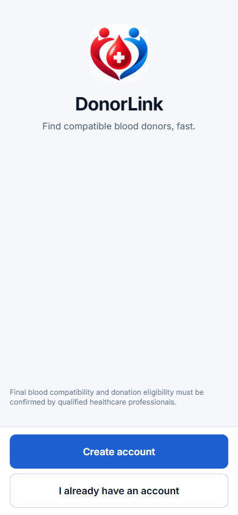
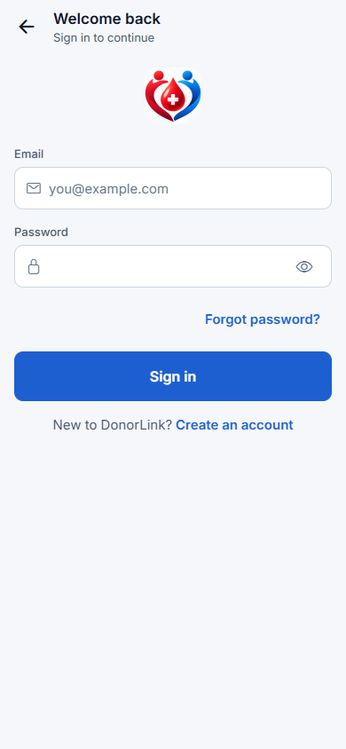
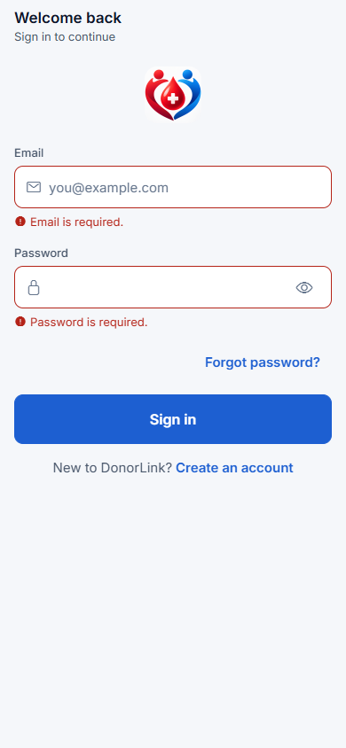
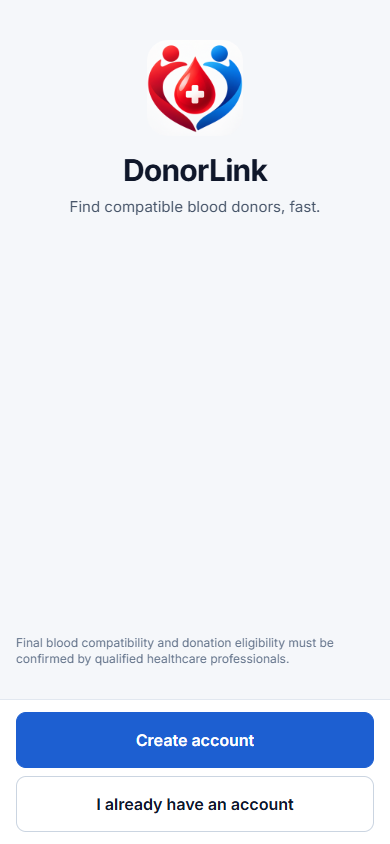

# DonorLink usability testing: final report of this package

Date prepared: 12 October 2026. Validated on branch `Testing`, commit `fd7f81b`, Expo SDK ~57.0.26, React Native 0.86.3.

## 1. Executive summary

* A complete, repeatable usability-testing package for the six PDF tasks (T1-T6) has been prepared: plan, consent, facilitator protocol, participant cards, observable success criteria, SEQ/SUS/debrief instruments, three Excel workbooks (observation, results/analysis, issue log), synthetic-data rules and an isolated Playwright suite.
* **The participant-based usability study is not part of this package's results.** No real participant data exists in the repository, and no participants were invented. The PDF states that sessions were completed and points to a Google Drive folder that this package could not open; its Table 16 still says "See folder". The workbooks are ready to take that data.
* A separate **synthetic proxy evaluation** now populates the workbooks to demonstrate their calculation and reporting workflow. Its five proxy personas and all findings are explicitly labelled synthetic; they are not evidence of human usability and must be replaced or validated by participant sessions.
* **Executed and passing:** the app's typecheck, lint and Jest suite (9 suites, 122 tests), and 10 credential-free Playwright checks of the signed-out screens on the Expo web preview.
* **Not executed:** the cross-account walkthrough (needs QA passwords typed by the project owner against live Appwrite Cloud) and anything on a native Android phone (no build or device available).
* **Findings:** no usability findings have been observed. Six *candidate* issues were found by reading the code and are logged as unverified (§13). Nine points in the PDF itself need a decision (§3 of `test-plan.md`), including that Section 9.3 says five tasks while Table 15 lists six.
* The application was not changed: `git diff` on tracked files is empty and only `testing/` is new.

## 2. Objectives and scope

PDF research questions: **RQ1** can first-time users create a request, find its status and respond unaided; **RQ2** are prototype issues UI-01…05 resolved; **RQ3** overall satisfaction by SUS. In scope: the six tasks, SEQ, SUS, debrief, severity-rated issues, Table 16. Out of scope here: the earlier Figma study (Section 3.4), push notifications, organization/admin screens, notification latency (NFR02).

## 3. Requirements extracted from the PDF

Nineteen mandatory requirements (R1-R19) and three additions (A1-A3) are traced in `test-plan.md` §2. Key ones: 5-8 participants with ≥ 2 donors and ≥ 2 blood searchers; consent plus separate recording consent; QA accounts and synthetic data only; ~20 min on an Android phone; think-aloud; scenario cards; SEQ 1-7 after each task; SUS (Brooke); 4-question debrief; completion = unaided ÷ attempting; assist after 60 s or two requests; abandoned at 3 min; Nielsen 0-4 severity; counts with a small-sample caveat.

## 4. Application and test environment

| Item | Value |
|---|---|
| Code | `Testing` @ `fd7f81b`; tracked files unmodified during validation |
| Stack | Expo Router app (`src/app`), Appwrite Cloud backend, server Function `donorlink-api` |
| Automated run | Windows 11, Node v24.19.0, Playwright 1.64.0 on pre-installed Chromium 151.0.7922.34, viewport 390 × 844, Expo web preview `http://localhost:8081`, backend from the existing `.env` (values not recorded) |
| Android | SDK, `adb`, and AVD `Medium_Phone` present; no device connected and no APK or development build; **not used** |
| Environment record | `results/automated/00-environment.json` (no secrets) |

Web preview is **not** equivalent to Android: no keychain, native date/time dialogs, Android back button, TalkBack or touch gestures, and the `Pick date & time` chip is hidden on web (see CAND-01).

## 5. Participant recruitment criteria

5-8 participants, ≥ 2 who have donated, ≥ 2 who have searched for blood for a family member, regular smartphone users, no group members, avoid the five students from the 18 Sept 2026 Figma test. Anonymous IDs P01-P08. The `Sessions` sheet computes category and an eligibility flag; the `Summary` sheet checks the criteria live. **Participants recruited by this package: 0.**

## 6. Ethical and privacy safeguards

Verbal or written consent (script from Appendix C.1), a separate recording consent, an optional screenshot-in-report consent, the right to stop at any time, participant IDs only, no names/contacts/faces, synthetic data only, `results/private/` git-ignored, no credentials in the repository. See `participant-introduction.md`.

## 7. Methodology and session procedure

Think-aloud; ~20 min: consent/intro 3 → six tasks with SEQ 11 → SUS 3 → debrief 3. Facilitator reads the card only. One neutral hint after 60 s or two requests (assist); abandon at 3 min. Reset checklist before and after each session, with no deletions. Full detail: `participant-protocol.md`.

## 8. The six tasks and success criteria

| ID | Task (PDF Table 15) | Success state |
|---|---|---|
| T1 | Sign in with the test account | Home visible without help |
| T2 | 2 units of O+ for an uncle at a Colombo hospital | Request submitted, shown as awaiting verification |
| T3 | Is my request verified; how many donors responded | States status and count matching ground truth |
| T4 | Donate today until 6 pm | Available with an end time of 18:00 saved |
| T5 | Alert asking for my blood group; agree | Opens the intended alert and accepts (confirmation dialog) |
| T6 | Find donation and request history | History open and one past record identified |

Per-task preconditions, accepted answers, non-success patterns, backend checks and screenshots: `task-success-criteria.md`. Participant wording: `task-scenarios.md`.

## 9. Test accounts and synthetic data

Roles only (no credentials): **QA donor** is the participant's account; **QA requester** creates the T5 alert request; **QA reviewer** verifies requests. The report says these accounts exist; **this package could not confirm that**, and confirming needs a live sign-in. Synthetic requests use hospital `ZZ USABILITY TEST HOSPITAL` and the note "USABILITY TEST", and are cancelled in the app after use. Details and risks (including real directory hospitals): `test-data/synthetic-data.md`.

## 10. Automated testing strategy and execution results

Automated checks are functional. They do not measure usability and do not replace participants.

| # | Check | Tool | Result | Evidence |
|---|---|---|---|---|
| 1 | `npm run typecheck` | tsc | **Pass** (exit 0) | `results/automated/01-typecheck.log` |
| 2 | `npm run lint` | expo lint | **Pass** (exit 0, no findings) | `02-lint.log` |
| 3 | `npm test` | Jest 29 / jest-expo | **Pass**: 9 suites, 122 tests (domain 80, Function handlers 42) | `03-jest.log`, `03-jest-report.json` |
| 4 | `public-screens.pw.ts` (10 tests) | Playwright, web preview | **Pass 10/10**, 0 failed, 0 flaky | `04-playwright.log`, `04-playwright-report.json` |
| 5 | `qa-e2e.pw.ts` (8 tests: requester → reviewer → donor) | Playwright | **Skipped** (QA credentials not set); written from source, **not executed** | n/a |
| 6 | Environment check | `check-environment.mjs` | 10 pass, 2 warnings (no Android device connected; no QA credentials in env) | `00-environment.json` |
| 7 | Native Android UI automation | none | **Blocked**: no build/device; Maestro not installed | n/a |

The typecheck, lint and Jest runs were repeated after the new files were added (to confirm the app's own checks still pass): all three pass. Two integration problems were found and fixed *inside* `testing/`: (a) Jest picked up `*.spec.ts` Playwright files, so they were renamed `*.pw.ts`; (b) the root `tsc` type-checks `testing/**/*.ts` and flagged one invalid Playwright role in the E2E draft, which was corrected. The app's `tsconfig.json` was left untouched.

The report (Section 8.3) cites 21 suites / 384 tests; this checkout has 9 / 122, so the report's figures cannot be reproduced from branch `Testing`. They may belong to branch `development`.

### Playwright checks executed (signed-out, web preview)

| ID | Check | Result |
|---|---|---|
| TC-PUB-01 | Welcome renders for a signed-out visitor | Pass |
| TC-PUB-02 | Login reachable from Welcome; Email and Password present | Pass |
| TC-PUB-03 | Empty login shows "Email is required." / "Password is required."; no session request sent | Pass |
| TC-PUB-04 | Malformed email shows "Enter a valid email address."; no request sent | Pass |
| TC-PUB-05 | Register reachable from Login | Pass |
| TC-PUB-06 | Forgot-password reachable from Login | Pass |
| TC-PUB-07 ×4 | Signed-out deep links `/requests/create`, `/donor/availability`, `/history`, `/notifications` redirect to Welcome, no app content shown | Pass |

*Figure 1: SS-002, TC-PUB-01. Welcome screen for a signed-out visitor (web preview, 390 × 844).*

*Figure 2: SS-001, context for T1. The sign-in screen a participant meets first.*

*Figure 3: SS-003, TC-PUB-03. Inline errors on an empty submit; no authentication request was sent.*

*Figure 4: SS-007, TC-PUB-07. A signed-out deep link to `/requests/create` lands on Welcome.*

All ten images are listed in `results/screenshot-register.csv`.

## 11. Participant testing results

**No human participant results are recorded here.** The workbooks contain only the separately labelled proxy demonstration data below. If sessions were run as the PDF states, enter their recording sheets and SUS forms into `observation-sheet.xlsx` and copy to `results-analysis.xlsx`. The PDF's own claim of completed sessions was not verified.

### Synthetic proxy evaluation (demonstration only)

Five simulated proxy personas completed all six scenarios using the source-informed web walkthrough. This is a test-project dataset, not a study with people. It uses the same outcomes, timing, SEQ and SUS fields so that the formulas, charts and Table 16 have visible values. The strongest proxy signals are T4 exact-time availability (0/5 unaided, one abandonment), T6 history discovery (2/5 unaided), and T3 response-count wording (3/5 unaided). The issue log records these as `WA-P01` through `WA-P04`, each marked **"Proxy finding — validate with people"**. Do not report any of these counts as participant results.

## 12. Task-level completion, timing, SEQ and SUS analysis

Not available (no data). The analysis is implemented and verified: `Task Metrics`, `Table 16`, `Summary` and `Charts` in `results-analysis.xlsx`. Verification: a copy of the workbook was filled with **synthetic** numbers in a scratch folder (never shipped) and evaluated with an independent formula engine; every output matched hand-computed values (for example unaided completion 2/5, mean unaided time 25 s, mean SEQ 4.0, SUS scores 100 / 50 / 75 with an incomplete questionnaire excluded, mean 75, SD 25). The three shipped workbooks evaluate with 0 formula errors while empty (2,261 formulas). They have not been opened in Excel itself.

## 13. Usability issue log and evidence

No issue has been *observed*. Candidate issues from reading the code (status "Needs verification", no severity, no participant counts) are in `issue-log.xlsx`:

| ID | Task | Concern (from code, not observed) | Evidence |
|---|---|---|---|
| CAND-01 | T4 | Exact "until 6 pm" cannot be set on web (picker chip hidden); Android needs two consecutive dialogs; other chips are relative (2 h / 8 h / 24 h / 3 d) | `src/components/ui/DonorLinkPickers.tsx:436-477` |
| CAND-02 | T4 | An end time that is not in the future is rejected, so sessions after 18:00 make T4 impossible as worded | `src/domain/validation.ts:266-269` |
| CAND-03 | T3 | Task says "responded"; the app shows "N of M donors accepted" plus Contacted/Accepted/Waiting/Declined | `RequestDetailsScreen.tsx:161`, `ResponseSummary.tsx:43-46` |
| CAND-04 | T2/T3 | Pending wording differs: "Awaiting verification", "waiting for verification", "Not yet verified" | `statuses.ts:28`, `RequestDetailsScreen.tsx:121,144` |
| CAND-05 | T2 | "Who is this for" (uncle) is optional, collapsed, and has no "uncle" option | `requests/create.tsx:28,148-173` |
| CAND-06 | T6 | History is not one of the four tabs (Home quick action or Profile row) | `(tabs)/index.tsx:29-34`, `(tabs)/profile.tsx:82` |

Link to the prototype study (RQ2): CAND-01 ↔ UI-01, CAND-03/04 ↔ UI-03, CAND-06 ↔ UI-04. These are areas to investigate, not conclusions.

## 14. Prioritized recommendations

| Priority | Action |
|---|---|
| **P1** | Reconcile with the sessions the PDF says were run: enter the recording sheets and SUS forms into the workbooks, fill Table 16, and add real issues (WA-nn). If no sessions took place, run them (5-8 participants) |
| **P1** | Run the sessions on an **Android phone** with a build from the final commit (the report's APK predates it and expires 21 Oct 2026). T4 cannot be tested as worded on web |
| **P1** | Correct the report text "five scenario tasks" to six; decide the T3 "responded" definition and the T4 time before sessions |
| **P1** | Pilot once to settle the T5 alert set-up and the T4 starting state |
| **P2** | Provide the QA account passwords to the person running `qa-e2e.pw.ts` and fix selectors on the first run; consider a separate Appwrite project |
| **P2** | Verify CAND-01…06 during sessions and rate them (Nielsen 0-4) |
| **P3** | Optional: add `"exclude": ["testing"]` to the app's `tsconfig.json` so the root typecheck no longer covers the testing folder (not done: it would change an app config file) |

## 15. Limitations, blockers, outstanding

| Item | State | Needed |
|---|---|---|
| Participant sessions | Not in this package | Real participants, device, consent |
| Native Android execution | Blocked | APK/development build, device or emulator, `adb` on PATH |
| QA accounts verification | Not confirmed | Project owner signs in or supplies credentials to the runner (must not be committed) |
| Cross-account E2E and backend verification | Written, not executed | Same as above; reviewer role confirmed |
| Signed-in screenshots (Home, request, availability, alert, history) | Not captured | Same; the E2E captures them on first run |
| Excel rendering | Not opened in Excel here | Open once to confirm drop-downs and charts |
| Shared Drive folder in the PDF | Not accessed | Owner's access |
| Cached workbook values | Absent (calculate on open) | None |

Not done on purpose, per the safeguards: creating or using accounts on the live backend, using the provisioning API key, deleting or resetting any data, changing permissions, schema, auth settings or app code.

## 16. Repeating the tests

See `README.md` ("Quick start" and "Running the participant study"). In short: `node scripts/check-environment.mjs` → `npm run typecheck && npm run lint && npm test -- --ci` → `cd automation && npm install && npx playwright test public-screens.pw` → (owner) set `QA_*` variables and `npx playwright test qa-e2e.pw` → run sessions per `participant-protocol.md` → analyse in the workbooks.

## 17. Appendix: evidence

* `results/automated/` : typecheck, lint, Jest (log + JSON), Playwright (log + JSON), environment JSON
* `results/screenshot-register.csv` : 10 screenshots (all automated, signed-out, no personal data)
* `screenshots/automated-tests/` : the images
* No participant-session evidence exists.

### Changes outside `testing/usability/`

None to the application. Files under `testing/` only; nothing in `src/`, `appwrite/`, `package.json`, `tsconfig.json`, `app.json`, `.env*` or `.claude/` was edited. (The in-app browser's preview server was started from the existing `.claude/launch.json`, which was not modified.)
